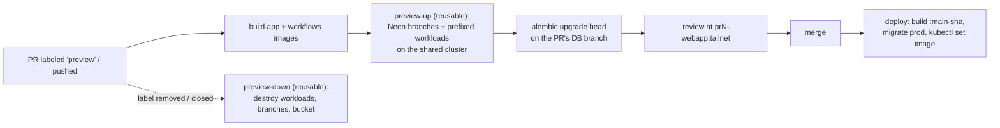

# lab-platform template app

[](https://github.com/Rosebud-Biosciences/lab-platform-template-app/actions/workflows/ci.yml)
[](LICENSE)

A hello-world app on
[lab-platform](https://github.com/Rosebud-Biosciences/lab-platform): a `uv`
workspace with a Postgres-backed webapp and a Dagster pipeline, plus CI that
gives every pull request **its own preview environment**, databases branched
from prod, and deploys `main` to prod. Every piece is tiny; the value is the
wiring.

Use it as a GitHub template ("Use this template"), then follow
[Adopt this template](#adopt-this-template). That copies `main`; the
[CHANGELOG](CHANGELOG.md) says which lab-platform release each tagged
release was validated with.

## How it works



- **Preview.** Label a PR `preview`, and CI builds its images and stamps a
  copy of the app on the shared cluster, on copy-on-write branches of prod's
  databases. The PR's migrations run on its own branch, never on prod's.
  Adding `preview:app-only` stamps only the webapp, pointed at prod's Dagster:
  up in about two minutes instead of ten, but pipeline changes go untested.
- **Teardown.** Removing the label or closing the PR destroys the preview,
  and a nightly sweep catches anything left behind.
- **Deploy.** Merging to `main` migrates prod (expand-contract, so the old
  version keeps serving) and rolls out the new image.

The `preview` label decides which PRs deploy; it is not a security boundary.
See [Security](#security).

## What's in it

| Path | What |
| --- | --- |
| `packages/db` | SQLAlchemy models and Alembic migrations |
| `packages/app` | FastAPI webapp, with a [marimo](https://marimo.io) notebook served as a page |
| `packages/workflows` | Dagster assets, jobs, a schedule and a sensor, including Ray fan-out |
| `packages/dataset` | The app's [tether](https://github.com/Rosebud-Biosciences/tether) dataset: one manifest per data object, and the code that opens them |
| `deployables.json` | The images CI builds and the preview stack deploys |
| `infra/preview` | The per-PR preview stack, built from the platform's modules |
| `Dockerfile` | One recipe for every image, per package via `TARGET_PACKAGE` |
| `.github/workflows` | CI, preview up and down, the nightly sweep, deploy, and the data jobs |
| `.github/scripts` | The tether half of the preview loop: fork, open, retire |

## Run it locally

```shell
uv sync                  # everything, including dev tooling
uv run pytest            # no database, services or containers needed
uv run ruff check . && uv run ty check

podman compose up --build                       # postgres, migrations, webapp on :8080
curl localhost:8080/                             # {"message":"Hello, world",...}
open http://localhost:8080/notebooks/            # the marimo page over the same database
uv run dagster dev -f packages/workflows/repo.py # Dagster UI on :3000
```

`docker compose` works the same. With no `DATA_REFS` set, the data assets
write to local stores under `.data/`.

## Ephemeral data

Every preview gets the same contract, so the app never knows how its data was
made: `DATABASE_URL` for its Postgres, `DATA_REFS` for its object and table
stores, and branches of the services' own databases (Dagster, MLflow, Argo).
The `FORK_PROVIDER` repository variable picks who makes them:

| | `tofu` (default) | `tether` |
| --- | --- | --- |
| Postgres | copy-on-write Neon branches | a tether fork of the Neon project |
| Object and table stores | fresh, **empty** copies | branches inside the **production** stores |
| The preview's access to prod data | none | read and write, no delete |
| Extra dependency | none | [tether](https://github.com/Rosebud-Biosciences/tether) |

Either way the preview's data is discarded when it closes; prod recomputes
with the merged code. The full comparison, the tether loop and the
twice-daily pins are in [docs/data.md](docs/data.md).

### Where the dataset lives

The dataset is a package, `packages/dataset`: tether's manifests next to the
Python that names the objects, so the app and the workflows import it like
any other package. A dataset several codebases share lives in a repository of
its own and comes in as a git submodule (`DATASET_ROOT`); see
[docs/data.md](docs/data.md#where-the-dataset-lives).

## Adopt this template

You need the platform's shared pieces first: a cluster with the Tailscale
operator and `preview_access` (so a preview stays in its own namespaces), the
bootstrap stack's CI and preview roles, an ECR repository, and Neon databases
for the app, Dagster, MLflow and Argo on a protected branch (a paid Neon
plan). Then:

1. Keep the `lab-platform` references pinned to a release (`v0.3.0`), and bump
   them all together.
2. Fill in `infra/preview/backend.tf` and
   `infra/preview/shared-platform.auto.tfvars` from the platform's outputs.
3. Set the repository variables (`CI_ROLE_ARN`, `PREVIEW_ROLE_ARN`,
   `CLUSTER_NAME`, `AWS_REGION`, `ECR_REPOSITORY`) and secrets
   (`NEON_API_KEY`, `TS_OAUTH_CLIENT_ID`, `TS_OAUTH_SECRET`,
   `PROD_DATABASE_URL`). Until then, only `ci` runs.
4. Give `CI_ROLE_ARN` deploy rights on the cluster, for `deploy.yml`.
5. Create the `preview` label, open a PR that adds a migration, and label it.
6. Point the dataset at your real stores, and commit a baseline on `main`.
7. Optionally, switch to tether mode.
8. Replace `SECURITY.md` and `.github/CODEOWNERS` with your own.

[docs/adopting.md](docs/adopting.md) has the details of each step.

## Learn more

- [What the app demonstrates](docs/app.md): notebooks as pages, login state
  that branches with a preview, app-managed groups, row-level security, and
  two Dagster patterns.
- [Preview data](docs/data.md): the two providers, the tether loop, and where
  the dataset lives.
- [Images](docs/images.md): one Dockerfile, adding a deployable, GPU builds.
- [Adopting the template](docs/adopting.md): every step in full.
- The platform's [preview environments](https://github.com/Rosebud-Biosciences/lab-platform/blob/main/docs/preview-environments.md)
  and [auth](https://github.com/Rosebud-Biosciences/lab-platform/blob/main/docs/auth.md)
  docs.

## Security

Read [SECURITY.md](SECURITY.md) before you adopt. A preview runs the pull
request's code with the preview role: confined to `preview-*` namespaces
once the platform's `preview_access` is in place, cluster-admin otherwise.
Give write access to this repository only to people you would trust with
that. In tether mode the preview's pods also write into the production
stores, in their own forks.

## Costs

The cluster, NAT and operators are shared and already running. A preview
adds one small node for its services, spot nodes for Ray workers while they
run, Neon branches (nearly free until written) and an empty bucket, and
scales to zero when idle.

## License

Apache-2.0, like the platform; see [NOTICE](NOTICE).
