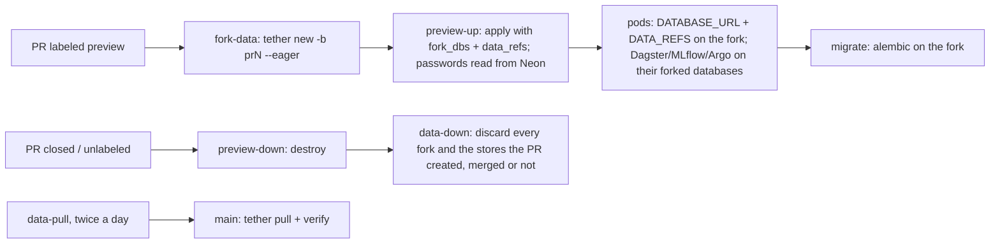

# Preview data

A preview needs data, and there are two ways to give it some. Both end in the
same contract, so nothing in `packages/` knows which is in use:

- `DATABASE_URL` — the preview's Postgres (`db/app`).
- `DATA_REFS` — JSON `key -> address`, one entry per object in the dataset's
  manifests, in the forms `tether open --json` prints
  (`s3://…/x.icechunk#<branch>`, `lake.table#<branch>`, `s3://…/x.lance#<branch>`,
  `s3://…/x.delta[@vN]`, `s3://…/prefix/`). `dataset.refs` parses it; a pinned
  version or snapshot makes the opener read-only. The webapp's `/data` echoes
  what it received.
- the **services' own databases** — Dagster's run storage, MLflow's tracking
  store, Argo's workflow archive (`db/dagster`, `db/mlflow`, `db/argo`) — each
  a branch of prod's, handed to the stamped service by the preview stack
  (`fork_dbs` in tether mode, `neon_branch_sources` in tofu mode). Service
  state is data too: a full preview shows prod's Dagster run history and MLflow
  experiments and writes to none of them. Prod's archived workflows are on the
  Argo branch too but unlisted: Argo keys its archive by namespace, and the
  preview's namespace-scoped server lists only its own (`preview-pr<N>-argo`), so the
  preview gets an archive of its own rather than a view of prod's. MLflow's
  artifacts are the one non-branchable piece (write-once blobs; tether's
  object-store backend has no fork): they go to a per-preview prefix
  (`<ephemeral bucket>/mlflow` or `<data bucket>/tether/mlflow/pr<N>/`) that
  `tether-down.sh` deletes when the preview retires.

## Two providers

`infra/preview`'s `fork_provider` (set from the `FORK_PROVIDER` repository
variable) selects the provider:

| | `tofu` (default) | `tether` |
| --- | --- | --- |
| Who forks | the preview stack, with the platform's `neon-branches`, `preview-storage`, `iceberg-branches` | CI's `fork-data` job, with `tether new -b pr<N> --eager` |
| Postgres (`db/app` and the services' `db/dagster`, `db/mlflow`, `db/argo`) | copy-on-write Neon branches, tuned compute (sources sharing a project share a branch) | tether fork of the Neon project (one branch serves every database), `--pin record` |
| Icechunk / Lance / Delta / files | fresh, **empty** copies in the preview's ephemeral bucket | branches inside the **production** stores, forked from the last pinned state |
| Iceberg | empty namespace of the preview's own | a branch on the prod table |
| Across pushes to the PR | data persists | data persists: the first run's fork is kept (re-label the PR for a fresh one) |
| Which prod state was tested | not recorded | the pinned dataset commit on `main` (`data-pull`, twice a day) |
| Landing preview data on prod | never: prod recomputes with the merged code | never: every fork is discarded on merge or close, and prod recomputes with the merged code |
| Preview's access to prod data | none | read/write (no delete) on the store prefixes, read/commit on the tables (`aws/data-access`) |
| Dependencies | none | `tether-vcs` (alpha; its Neon and Iceberg backends are `experimental`) |

Two facts about tether mode belong next to the decision. A fork of an Iceberg
table on S3 Tables is a branch on the *production* table, so preview pods need
commit rights IAM cannot scope to a branch — the code is trusted, tether's
operation log and `verify` audit it. And user refs on an S3 Tables table
suspend its automatic maintenance while they exist, so forks are short-lived
and swept.

## The tether loop

The tether loop, end to end (tether mode):



`data-pull.yml` runs in both modes: it is the record of which prod state each
dataset commit describes, and the baseline tether-mode previews fork from.
`tether-matrix.yml` (weekly, **off** until `ENABLE_TETHER_MATRIX=true`) forks
every store, writes through the store assets (`data_stores_job`), pins, diffs, dry-runs a promote
and releases — tether's live test against the real services, reported per
backend in one self-refreshing issue. Backends that need a service of their
own (DuckLake, lakeFS, Dolt) are not registered; `tether add` them when you run
one.

## Where the dataset lives

The dataset is a package, `packages/dataset`: the tether root (`tether.toml`,
`.tether/objects/`) and the Python that names those objects (`dataset.refs`)
in one directory, so `workflows` and `app` depend on it like they depend on
`db`, the images carry it, and `packages/dataset/tests/test_manifests.py` fails
the moment the manifests, the key constants and `infra/preview/data.tf` stop
agreeing. Adding a store is `tether add`, one constant, one asset, one line of
HCL. This is the shape for a dataset one app owns — the greetings-derived
stores here.

A dataset several codebases share is tether's native case (its guides register
the *code* repository as an object of the dataset, not the reverse) and it
lives in a repository of its own. Bring it into this repo as a git submodule
and point the tether machinery at it:

```shell
git submodule add git@github.com:your-org/your-dataset.git datasets/lab
# repository variable DATASET_ROOT=datasets/lab
```

Every `tether-*.sh` script and the `data-pull`, `preview-*`, `sweep` and
`tether-matrix` jobs read `DATASET_ROOT` (default `packages/dataset`), run
tether inside it, and run git against the repository that *contains* it — the
dataset repo, for a submodule. Three consequences follow from that:

- the `pr<N>` bookmark branches are pushed to, and retired from, the dataset
  repo, so the checkout needs a token or deploy key with write access to it
  (the default `GITHUB_TOKEN` only reaches this repo); the workflows already
  check out with `submodules: true`;
- `data-pull.yml` commits to the dataset repo's default branch, and this repo's
  submodule pointer trails it until bumped — the commented `gitsubmodule`
  ecosystem in `.github/dependabot.yml` opens those bumps as PRs;
- the code that names the objects (`dataset.refs`) still lives here, so the
  dataset repo's manifests and this package's keys are checked by the same
  test — set `DATASET_ROOT` for `pytest` too, or keep a `packages/dataset`
  whose `tether.toml` is a thin registration of the shared repo's objects.

**A copy that keeps tracking this template** (a staging or sandbox
deployment that pulls every template fix verbatim) hits the one thing in
`packages/dataset` that is not the template's: *where* each object lives. A manifest holds both what the code
relies on (the object's key, kind and policy) and its locator (bucket, Neon
project, table bucket, region), and tether commits them together. Two ways to
hold real locators in such a copy:

- **Keep the dataset here and mask the locators in the drift check.** This
  repo ships the check: `.github/workflows/template-drift.yml`, inert until a
  copy sets the `TEMPLATE_REPOSITORY` variable, compares the paths in
  `.github/template-drift/shared-paths` with the template's. It rewrites the
  locator values to a placeholder on both sides first
  (`deployment-values.sed`) and ignores what the copy's data has recorded
  (each manifest's state and pins, which `data-pull` moves twice a day); a
  script of the copy's own fills in the real locators from its
  infrastructure outputs. Keys, kinds and policies still have to match. One
  repo per deployment.
- **Give each deployment a dataset repository of its own**, brought in as a
  submodule (above). The shared code then carries no locators at all, but each
  deployment has a second repo, and nothing compares its manifests with the
  template's: an object added here must be added there by hand.

`TETHER_REV` pins reproductions across the boundary the same way in both
layouts: `TETHER_REV=<dataset commit> uv run python make_report.py` opens
every object at that commit's pins.

## On a laptop

With no `DATA_REFS` set, the store assets (`data_stores_job` in the Dagster
UI) write to local stores under `.data/` (`DATA_ROOT` to move it) with a sqlite
Iceberg catalog: every backend in the matrix runs on a laptop, and
`cd packages/dataset && uv run tether status` works against the same
directory.
